<div align="center">

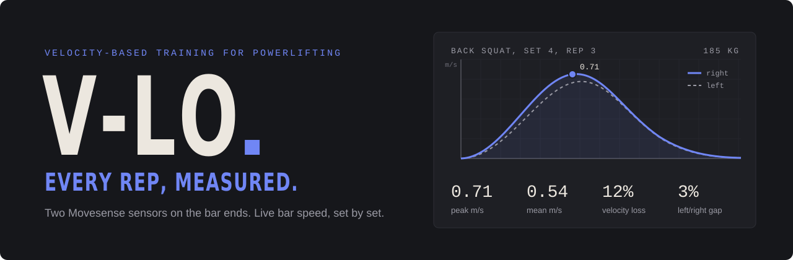

**Velocity-based training for powerlifters, built on two off-the-shelf Movesense sensors and a web app for athletes and coaches.**

### [▶ Open the V-LO web app](https://sportstechveloproject.github.io/.github/code/website/)


[Why VBT](#why-vbt) · [The problem](#the-problem) · [How it works](#how-it-works) · [The app](#the-app) · [Results](#results) · [Get started](#get-started) · [Team](#team)

<sub>Click a section below to open it.</sub>

</div>

<br>

<table>
  <tr>
    <td align="center" width="25%">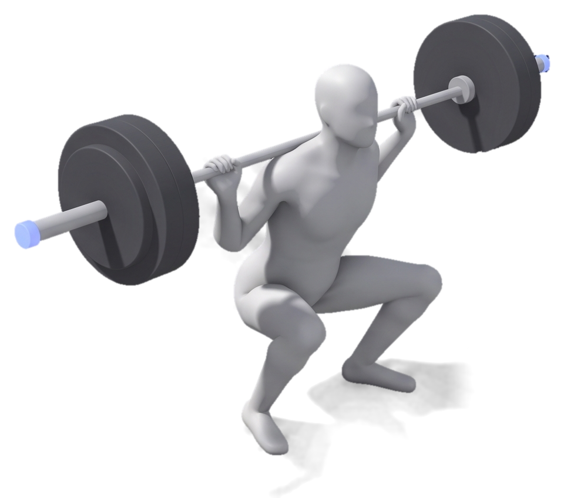<br><sub><b>Back squat</b></sub></td>
    <td align="center" width="25%">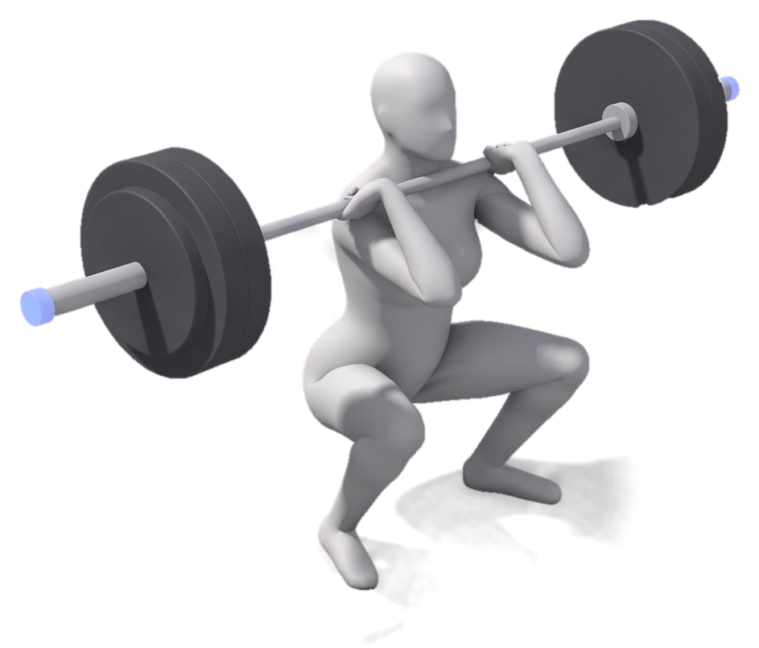<br><sub><b>Front squat</b></sub></td>
    <td align="center" width="25%">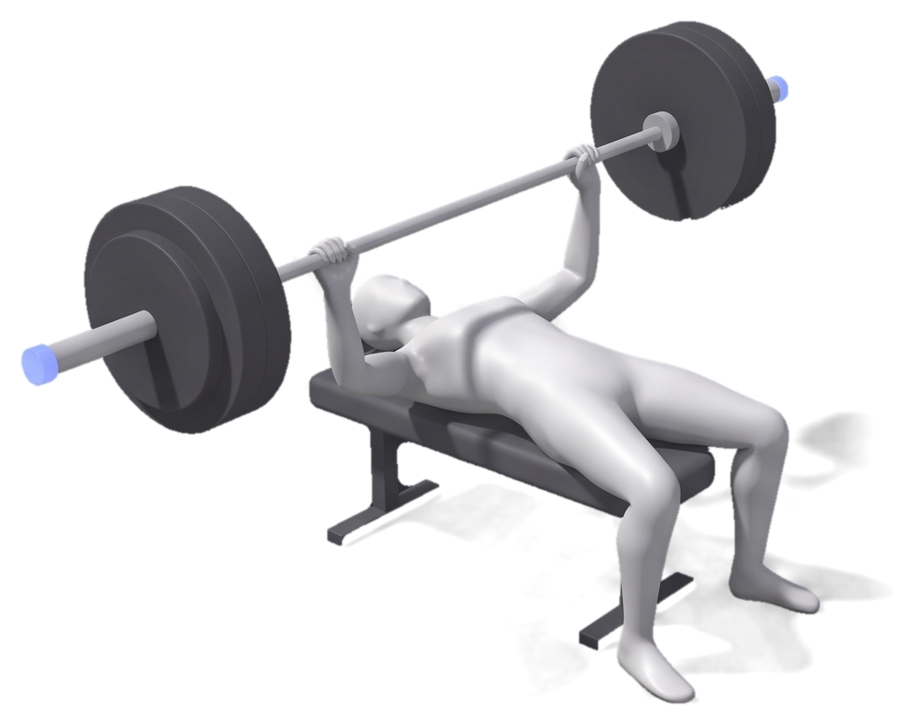<br><sub><b>Bench press</b></sub></td>
    <td align="center" width="25%">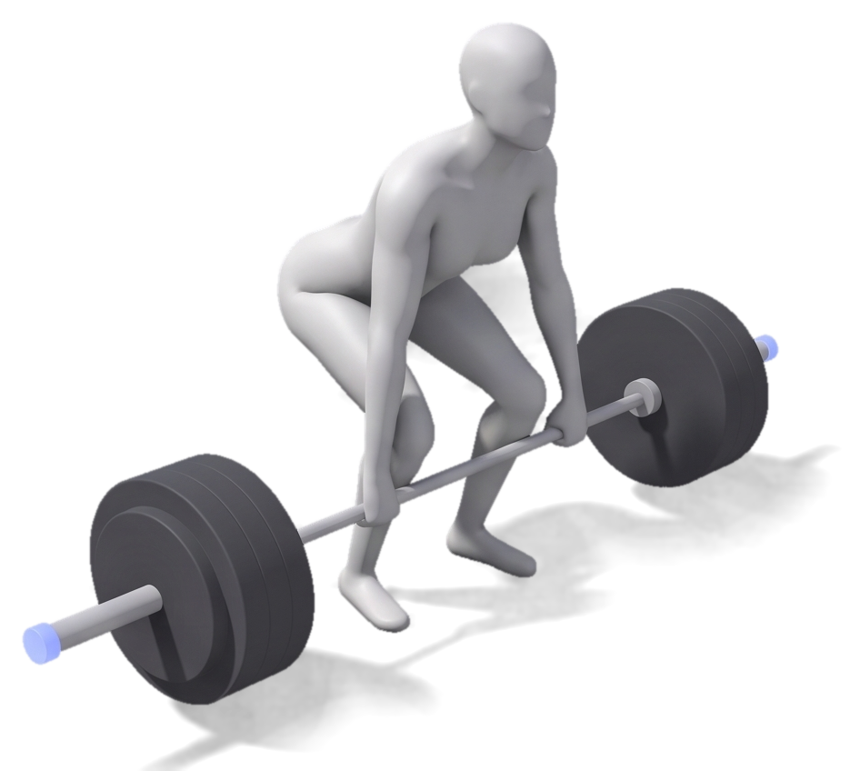<br><sub><b>Deadlift</b></sub></td>
  </tr>
</table>

---

<a id="why-vbt"></a>
<details>
<summary><h1>🏋️ Why velocity-based training?</h1></summary>
<br>

<table>
  <tr>
    <td width="58%" valign="top">

Traditional programs prescribe load as a fixed percentage of your 1RM. But your strength changes day to day with sleep, stress and fatigue, so Sunday's spreadsheet may be wrong by Thursday.

**Velocity-based training (VBT)** uses bar speed instead. As the load gets closer to your max, the bar slows down in a predictable way, which gives a live, objective readout of how hard a set really is.

✅ **Autoregulate:** load for the day you're actually having<br>
✅ **Manage fatigue:** stop a set when bar speed drops too far<br>
✅ **Estimate 1RM:** without testing a true max<br>
✅ **Train with intent:** a number after every rep makes you push

VBT gives strength gains similar to percentage-based training, at lower training loads.

  </td>
    <td width="42%" align="center">
      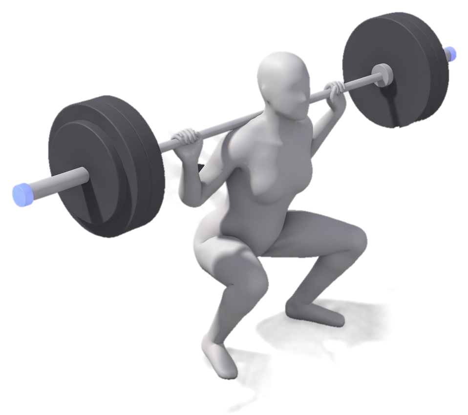
    </td>
  </tr>
</table>

## Velocity zones

Every set is classified by its mean bar speed:

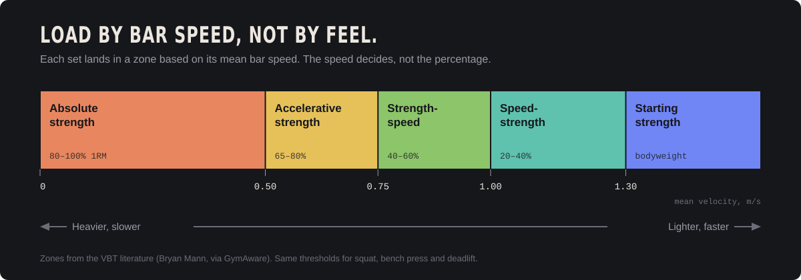

<details>
<summary><h3>Zones as a table · click to open</h3></summary>
<br>

| Zone | Mean velocity | Typical % 1RM | Training effect |
|---|---|---|---|
| 🔵 Starting strength | > 1.30 m/s | bodyweight | Overcoming inertia: jumps and throws |
| 🟢 Speed-strength | 1.00–1.30 m/s | 20–40% | Speed first, strength second |
| 🟢 Strength-speed | 0.75–1.00 m/s | 40–60% | Moderately heavy loads, as fast as possible |
| 🟡 Accelerative strength | 0.50–0.75 m/s | 65–80% | Driving heavy loads as fast as possible |
| 🟠 Absolute strength | < 0.50 m/s | 80–100% | Maximal force: heavy triples, doubles, singles |

</details>

</details>

---

<a id="the-problem"></a>
<details>
<summary><h1>🎯 The problem</h1></summary>
<br>

Coaches report three barriers to using VBT today:

<table>
  <tr>
    <td align="center" width="33%">💸<br><b>Expensive</b><br><sub>The most accurate devices, linear position transducers, cost a lot.</sub></td>
    <td align="center" width="33%">🔌<br><b>Hard to use</b><br><sub>Cables and setup get in the way of the lift.</sub></td>
    <td align="center" width="33%">📉<br><b>Limited accuracy</b><br><sub>Cheaper wireless IMUs suffer from drift and bar rotation.</sub></td>
  </tr>
</table>

> [!NOTE]
> **Our research question:** Can two end-mounted IMUs give accurate enough mean concentric velocity for feedback during training, despite irregular barbell rotation?

<details>
<summary><h3>Why do cheaper sensors struggle? · click to open</h3></summary>
<br>

- **Integration drift.** Velocity comes from integrating acceleration, so small errors add up over time.
- **Irregular bar rotation.** The bar tilts and rotates mid-lift, so the sensor axes stop lining up with the movement.
- **One side only.** A single sensor can't tell whether the left and right sides of the bar move differently.

</details>

</details>

---

<a id="how-it-works"></a>
<details>
<summary><h1>⚙️ How it works</h1></summary>
<br>

V-LO puts **one Movesense sensor on each end of the bar**. The velocitydrift of both sensors are compared and the data from the sensor with the most linear drift are used for velocity estimations.

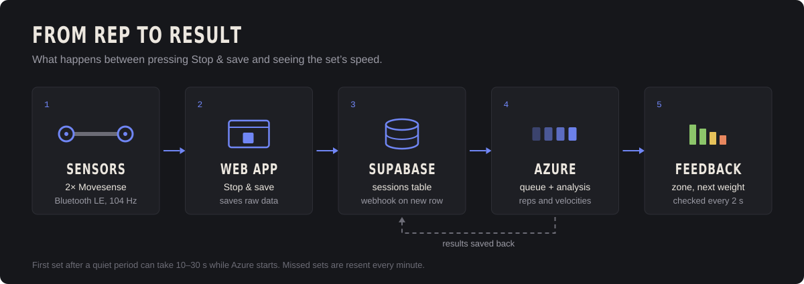

<table>
  <tr>
    <td width="50%" valign="top">

**From acceleration to velocity**

1. **Orientation:** the Madgwick filter fuses accelerometer and gyroscope data
2. **Drift correction:** The velocity drift is approximated as linear. Estimating a gradient coefficient from the first and last half second of data. 
3. **Rep detection:** Velocity peaks are identified by comparing number of peaks to the known number of repetitions performed. 
4. **Velocity:** For each repetition the mean velocity is estimated by integrating the acceleration over time for each repetition. Only the velocity data with a value above the approximated drift is used. The peak velocity is estimated using the velocity curves peak height. 
  </td>
    <td width="50%" valign="top">

**Why Movesense, not a custom board?**

A custom IMU would mean building our own firmware, Bluetooth stack and enclosure. That time would come out of the data analysis and the user experience, which are our core contributions.

Movesense is commercially available, with a 9-axis IMU and Bluetooth Low Energy.

  </td>
  </tr>
</table>

<details>
<summary><h3>Data pipeline in detail · click to open</h3></summary>
<br>

1. **Save.** You press **■ Stop & save**. The web app saves the sensor data and adds a row to the `sessions` table in Supabase.
2. **Trigger.** A Supabase webhook fires on the new row and sends the recording to our app on Azure.
3. **Analyze.** Azure queues the recording, runs the analysis code (`Squats2`) and saves the reps and velocities back to Supabase.
4. **Show.** The web app checks for results every 2 seconds and shows the set's velocity, whether it hit the target zone, and a suggested next weight. No refresh needed.

- **Cold start:** if Azure has been idle, the first set can take 10–30 s.
- **Retries:** missed sets are resent automatically every minute.
- **Errors:** if a set can't be analyzed, it shows the reason instead of a result.

</details>

</details>

---

<a id="the-app"></a>
<details>
<summary><h1>📱 The app</h1></summary>
<br>

<table>
  <tr>
    <td width="40%" align="center">
      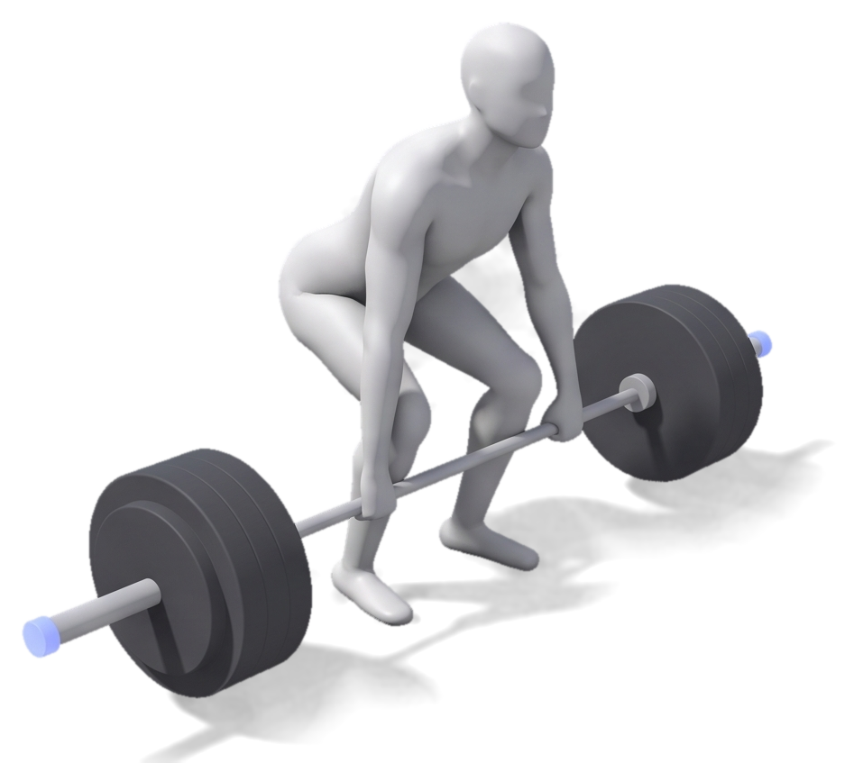
    </td>
    <td width="60%" valign="top">

**1.** 📍 Place the sensors on the bar ends<br>
**2.** 📶 Connect in the web app<br>
**3.** 🏋️ Pick exercise and weight<br>
**4.** 📊 Lift and get feedback on every rep

After each set you see **peak and mean velocity**, a **rep-by-rep readout**, **consistency**, whether you **hit the target zone**, and a **suggested next weight**.

Web-based, so it works on any phone, tablet or laptop.

  </td>
  </tr>
</table>

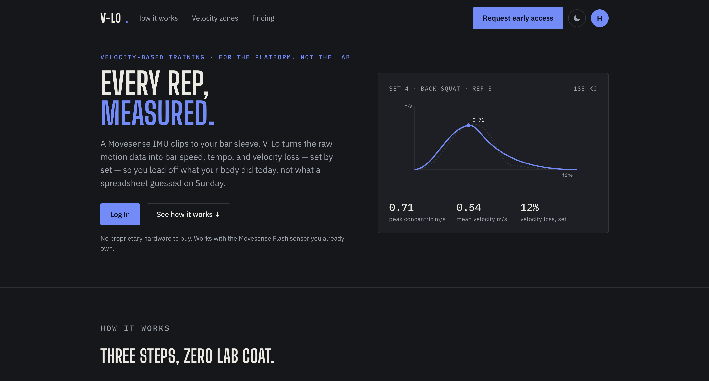

Coaches get a team view with training volume, average bar speed per lift, and PR leaderboards for each velocity zone.

<table>
  <tr>
    <td align="center">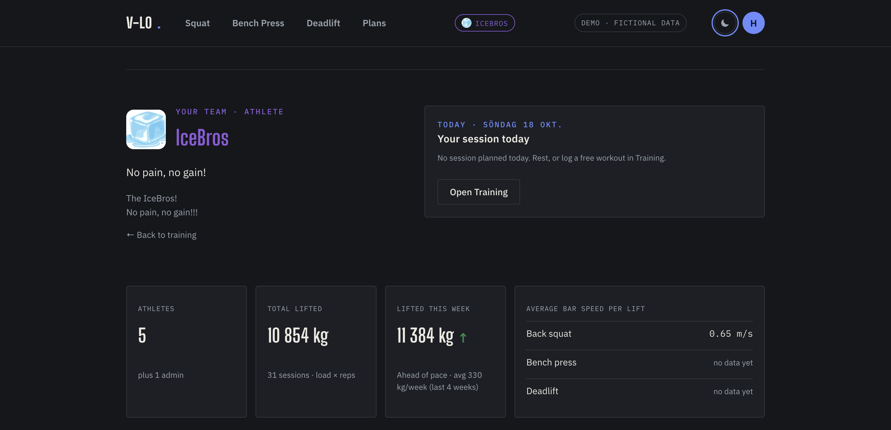<br><sub><b>Team dashboard</b></sub></td>
    <td align="center">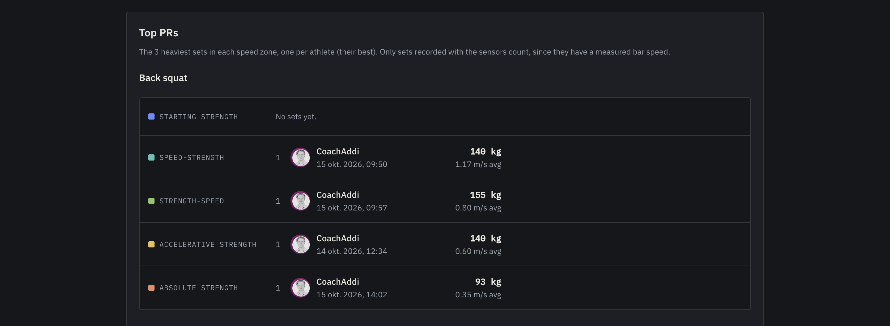<br><sub><b>Top PRs per velocity zone</b></sub></td>
  </tr>
</table>

➡️ **More screenshots:** [Website walkthrough](docs/images/website/README.md)

</details>

---

<a id="results"></a>
<details>
<summary><h1>📊 Results</h1></summary>
<br>

We validated V-LO against a **GymAware linear position transducer**, a gold-standard reference that recorded the same reps.

<table>
  <tr>
    <td align="center" width="33%"><h2>4</h2><sub>participants, 6 reps in each velocity zone</sub></td>
    <td align="center" width="33%"><h2>Low&nbsp;speed</h2><sub>is where V-LO matches GymAware most closely</sub></td>
  </tr>
</table>

V-LO's average and peak velocity follow GymAware closely. Estimates are most accurate at lower velocities and drift more for faster movements.
The table displays the mean average difference (MAD) between the gymAware data and the V-LO velocity approximation and the standard deviation(MAD SD). The data is separated by the speed zone the repetitions are performed in. 
| Metric | Absolute Strength MAD | Absolute Strength MAD SD | Speed Strength MAD | Speed Strength MAD SD | Starting Strength MAD | Starting Strength MAD SD |
|--------|----------------------:|-------------------------:|-------------------:|----------------------:|----------------------:|-------------------------:|
| Mean velocity [m/s] | 0.03 | 0.04 | 0.05 | 0.06 | 0.33 | 0.17 |
| Peak velocity [m/s] | 0.02 | 0.02 | 0.06 | 0.03 | 0.21 | 0.13 |
</details>

---

<a id="get-started"></a>
<details>
<summary><h1>🚀 Get started</h1></summary>
<br>

```bash
python -m http.server 8080
```

Then open [localhost:8080/vlo.html](http://localhost:8080/vlo.html) in **Chrome or Edge** (they support Web Bluetooth, which connects to the sensors) and log in with your own account.

> [!WARNING]
> The analysis runs on Azure, so changes to the analysis code also need a deploy. Check with the team before deploying.

## Recording a set

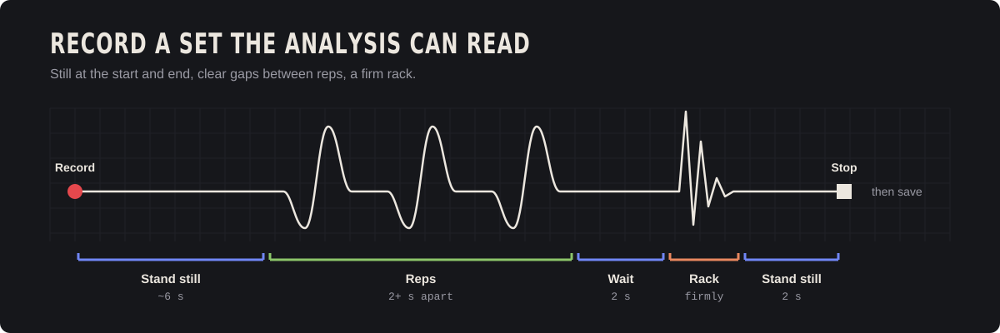

Standing still at the start gives a clean baseline, gaps between reps help separate them, and a firm rack marks the end of the set.

</details>

---

<a id="limitations"></a>
<details>
<summary><h1>🧭 Limitations and roadmap</h1></summary>
<br>

<table>
  <tr>
    <td width="45%" valign="top">

**Known limitations**

- Small number of participants
- The participants were not professional powerlifters
- The evaluation was only done for squats
- Unreliable Bluetooth connection
- Slow first set after Azure is idle

  </td>
    <td width="55%" valign="top">

**Next up**

- [ ] **More exercises**, including team sports
- [ ] **Intelligent coach platform** with programs and benchmarks
- [ ] **Other lifting equipment** beyond the barbell
- [ ] **Wearable version** that tracks the athlete
- [ ] **Wake Azure on connect** to skip the cold start

  </td>
  </tr>
</table>

</details>

---

<a id="repository"></a>
<details>
<summary><h1>📁 Repository</h1></summary>
<br>

| Folder | Contents |
|---|---|
| [`code/`](code/) | Sensor streaming, processing pipeline and web app |
| [`data/`](data/) | Recorded sensor data and evaluation data |
| [`docs/`](docs/) | Documentation, images and detailed READMEs |
| [`ISSUE_TEMPLATE/`](ISSUE_TEMPLATE/) | Templates for reporting issues |

</details>

---

<a id="team"></a>
<details>
<summary><h1>👥 Team</h1></summary>
<br>

<table>
  <tr>
    <td align="center">
      <a href="https://github.com/arvidaxe"><br><b>Arvid</b></a>
    </td>
    <td align="center">
      <a href="https://github.com/GreipurGislason"><br><b>Greipur</b></a>
    </td>
    <td align="center">
      <a href="https://github.com/HugoPersson01"><br><b>Hugo</b></a>
    </td>
    <td align="center">
      <a href="https://github.com/siljekongstorpjohansen"><br><b>Silje</b></a>
    </td>
    <td align="center">
      <a href="https://github.com/svanbergaddi"><br><b>Svanberg</b></a>
    </td>
  </tr>
</table>

<details>
<summary><h3>Roles · click to open</h3></summary>
<br>

<table>
  <tr>
    <td colspan="2" align="center">

### 🧭 Scrum master
[**Svanberg (Addi)**](https://github.com/svanbergaddi)<br>
Led the sprints and built the data pipeline from Supabase to Azure and back. Worked across both the UI and the code.

  </td>
  </tr>
  <tr>
    <td width="50%" valign="top">

### 🎨 UI / UX
Designed and built the web app: the dashboard, the flow for connecting sensors and picking a lift, and how feedback is shown after each set.

- [**Hugo**](https://github.com/HugoPersson01)
- [**Greipur**](https://github.com/GreipurGislason)

  </td>
    <td width="50%" valign="top">

### 🐍 Data and analysis
Wrote the Python code that processes the sensor data: filtering, orientation, rep detection and velocity estimation.

- [**Silje**](https://github.com/siljekongstorpjohansen)
- [**Arvid**](https://github.com/arvidaxe)

  </td>
  </tr>
</table>

</details>

</details>
