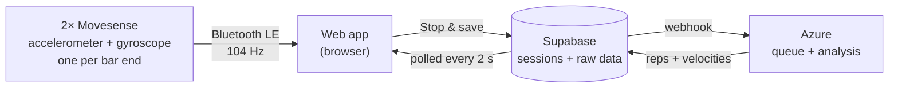

<div align="center">

# V-LO · A Velocity-Based Training Platform

**Dual-IMU barbell velocity tracking**

V-LO measures how fast the barbell moves on every rep, using two sensors on the bar ends, and turns it into feedback on a web dashboard.


Designed for powerlifting: **Squat · Bench press · Deadlift**

</div>

---

## Why velocity-based training?

Traditional strength programs prescribe load as a fixed percentage of your one-repetition max (1RM). But your 1RM isn't fixed. Sleep, stress, nutrition and accumulated fatigue all change what you can lift on a given day, so a percentage written on Sunday may be too heavy or too light by Thursday.

In **velocity-based training (VBT)**, load and effort are guided by bar speed instead. Bar speed falls in a predictable way as load gets closer to your max, so it works as a live, objective readout of how hard a set actually is. With VBT you can:

- **Autoregulate load** by adjusting weight to what your body can do today, not what a spreadsheet predicted.
- **Manage fatigue** by ending a set when bar speed drops too far, instead of grinding out reps that only add fatigue.
- **Estimate 1RM** from submaximal sets, without testing a true max [2].
- **Train with intent**, because seeing a number after every rep makes athletes push each one.

And it works: VBT gives strength gains in the squat, bench press and deadlift similar to percentage-based training, at lower training loads [1].

**Intended users:** powerlifters and strength athletes, and the coaches who follow their data.

## The problem

Coaches report that today's VBT systems are [3]:

| | |
|---|---|
| 💸 **Expensive** | The most accurate devices, linear position transducers, cost a lot [4]. |
| 🔌 **Hard to use** | Cables and setup get in the way of the lift. |
| 📉 **Limited accuracy** | Cheaper wireless IMUs suffer from drift and bar rotation. |

In short, existing systems are either accurate but pricey and cabled, or cheap and wireless but less accurate.

### Why cheaper sensors struggle

- **Integration drift.** Velocity comes from integrating acceleration, so small errors add up over time.
- **Irregular bar rotation.** The bar tilts and rotates mid-lift, so the sensor axes stop lining up with the movement.
- **One side only.** A single sensor can't tell whether the left and right sides of the bar move differently.

> **Research question:** Can two end-mounted IMUs give accurate enough mean concentric velocity for feedback during training, despite irregular barbell rotation?

## Technical approach



### From acceleration to velocity

1. **Orientation.** The Madgwick filter fuses accelerometer and gyroscope data to track the bar's movement relative to the earth's orientation [6].
2. **Separating repetitions.** A moving-average filter estimates a baseline, and peaks above it are counted as reps. Each peak is checked against a ±50 ms window to reject noise.
3. **Velocity estimation.** Acceleration is integrated over each rep, assuming zero velocity at the start of the lift.
4. **Left and right compared.** Peak and mean velocity are computed per rep for each side and then compared. Detecting reps on both sides also lets us cross-check: one sensor can flag extra peaks after a set that the other doesn't.

### Why Movesense, not a custom board?

A custom IMU would mean building our own firmware, Bluetooth stack and enclosure. That time would be taken from the data analysis and the user experience, which are our core contributions. Movesense is commercially available, with a 9-axis IMU and Bluetooth Low Energy [5].


### Data pipeline

What happens after a set, from the button press to the result on screen:

1. **Save.** You press **■ Stop & save**. The web app saves the sensor data and adds a row to the `sessions` table in Supabase.
2. **Trigger.** A Supabase webhook fires when the new row appears and sends the recording to our app on Azure.
3. **Analyze.** Azure puts the recording in a queue, runs the analysis code (`Squats2`), and saves the detected reps and velocities back to Supabase.
4. **Show.** The web app checks for results every 2 seconds. The set then shows its velocity, whether it hit the target zone, and a suggested next weight, with no page refresh needed.

**Good to know**

- **Cold start:** If the Azure app has been idle, the first set can take 10–30 seconds to analyze. Later sets are faster.
- **Retries:** Sets that were missed are resent automatically every minute.
- **Errors:** If the analysis can't read a set, the set shows the reason instead of a result.

## User interaction

1. 📍 **Place** the sensors on the bar ends
2. 📶 **Connect** in the web app
3. 🏋️ **Pick** exercise and weight
4. 📊 **Lift** and see feedback for every rep

The app is web-based, so it works on any phone, tablet or laptop. Feedback includes **peak and mean velocity**, a **rep-by-rep readout**, **consistency**, whether the set **hit the target zone**, and a **suggested next weight**. Each set is also classified into a velocity zone:

| Zone | Mean velocity | Typical % 1RM | Training effect |
|---|---|---|---|
| 🔵 Starting strength | > 1.30 m/s | bodyweight | Overcoming inertia: jumps and throws |
| 🟢 Speed-strength | 1.00–1.30 m/s | 20–40% | Speed first, strength second |
| 🟢 Strength-speed | 0.75–1.00 m/s | 40–60% | Moderately heavy loads, as fast as possible |
| 🟡 Accelerative strength | 0.50–0.75 m/s | 65–80% | Driving heavy loads as fast as possible |
| 🟠 Absolute strength | < 0.50 m/s | 80–100% | Maximal force: heavy triples, doubles, singles |

Coaches also get a team view with training volume, average bar speed per lift, and PR leaderboards per velocity zone.

<table>
  <tr>
    <td></td>
    <td></td>
  </tr>
  <tr>
    <td align="center"><em>Team dashboard</em></td>
    <td align="center"><em>Top PRs per velocity zone</em></td>
  </tr>
</table>

➡️ **More screenshots and explanations:** [Website walkthrough](docs/images/website/README.md)

## Results

V-LO was validated against a **GymAware linear position transducer**, a gold-standard reference device, recording the same repetitions.

- **Setup:** 4 participants each performed 6 repetitions in each velocity zone.
- **Takeaway:** V-LO's average and peak velocity estimates follow GymAware closely. They are **most accurate at lower velocities** and deviate more for faster movements.
- **Usability:** In a preliminary survey, **80%** of test users found the system easy to set up and use.

## Limitations and future work

**Known limitations to address**

- Small number of participants
- Sensitivity to sensor placement
- Unreliable Bluetooth connection
- Slow first analysis when the Azure app is idle (10–30 s cold start)

**Future work**

- [ ] **More exercises.** Go beyond the big three, for example adapting to team sports where athletes train for explosiveness.
- [ ] **Intelligent coach platform.** Lifting programs, measurables, benchmarks and insights in one place.
- [ ] **Other lifting equipment.** Adapt the sensors and algorithm beyond the barbell.
- [ ] **Make it wearable.** Track movement from the athlete, not only the bar.
- [ ] **Wake Azure on connect.** Start the Azure app as soon as a sensor connects, so the first set isn't delayed by a cold start.

## Getting started

### Run the web app locally

1. Pull the code.
2. From the folder with `vlo.html`, start a local server:
   ```bash
   python -m http.server 8080
   ```
3. Open [localhost:8080/vlo.html](http://localhost:8080/vlo.html) in **Chrome or Edge**. These browsers support Web Bluetooth, which is needed to connect to the sensors.
4. Log in with your own account.

> ⚠️ **Changing the analysis code?** The analysis runs on Azure, so changes there also need a deploy. Check with the team before deploying.

### How to record a set

The analysis currently works best when recordings follow this pattern:

```
● Record → stand still ~6 s → reps (2+ s apart) → wait 2 s → rack firmly → stand still 2 s → ■ Stop
```

- **Standing still at the start** gives the algorithm a clean baseline.
- **Leaving 2+ seconds between reps** helps it separate one repetition from the next.
- **Racking firmly and staying still at the end** makes the end of the set easy to detect.

## Repository structure

| Folder | Contents |
|---|---|
| [`code/`](code/) | Source code: sensor streaming, processing pipeline and web app |
| [`data/`](data/) | Recorded sensor data and evaluation data |
| [`docs/`](docs/) | Documentation, images and detailed READMEs |
| [`ISSUE_TEMPLATE/`](ISSUE_TEMPLATE/) | Templates for reporting issues |

## Team

**Arvid · Greipur · Hugo · Silje · Svanberg**

## References

1. H. F. Dorrell, M. F. Smith and T. I. Gee, "Comparison of Velocity-Based and Traditional Percentage-Based Loading Methods on Maximal Strength and Power Adaptations," *Journal of Strength & Conditioning Research*, vol. 34, no. 1, pp. 46–53, 2020. [doi:10.1519/JSC.0000000000003089](https://doi.org/10.1519/JSC.0000000000003089)
2. J. Weakley, B. Mann, H. Banyard, S. McLaren, T. Scott and A. Garcia-Ramos, "Velocity-Based Training: From Theory to Application," *Strength & Conditioning Journal*, vol. 43, no. 2, pp. 31–49, 2020.
3. S. W. Thompson, P. Olusoga, D. Rogerson, A. Ruddock and A. Barnes, "Is it a slow day or a go day?: The perceptions and applications of velocity-based training within elite strength and conditioning," *International Journal of Sports Science & Coaching*, vol. 18, no. 4, pp. 1217–1228, 2023.
4. I. Jukic, A. King, C. A. Sousa et al., "Implementing a velocity-based approach to resistance training: the reproducibility and sensitivity of different velocity monitoring technologies," *Scientific Reports*, 13, 7152, 2023. [doi:10.1038/s41598-023-34416-0](https://doi.org/10.1038/s41598-023-34416-0)
5. Movesense, "Movesense Sport." [movesense.com/movesense-sport](https://www.movesense.com/movesense-sport/)
6. S. O. H. Madgwick, A. J. L. Harrison and R. Vaidyanathan, "Estimation of IMU and MARG orientation using a gradient descent algorithm," *2011 IEEE International Conference on Rehabilitation Robotics*, Zurich, 2011, pp. 1–7. [doi:10.1109/ICORR.2011.5975346](https://doi.org/10.1109/ICORR.2011.5975346)

